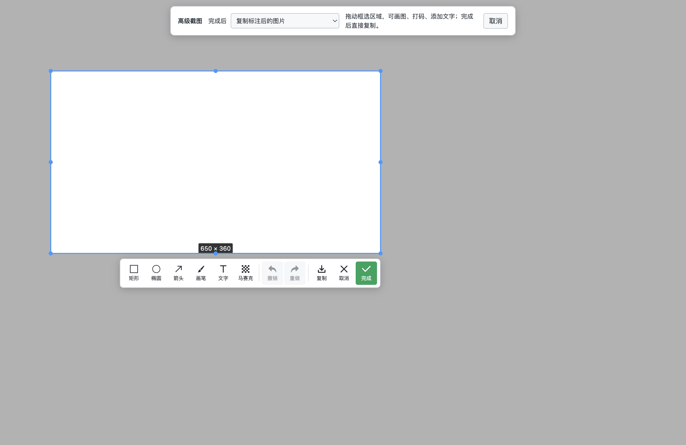

# v0.7.0 验证记录

测试源提交：`ae4aa371caf9a217754532e779faacdf11a40048`。

[GitHub Actions CI](https://github.com/liyongliao/lolPing/actions/runs/38398022690) 两端工作流成功。

| 检查 | Windows x64 | macOS Apple Silicon |
| --- | --- | --- |
| 类型检查 | 通过 | 通过 |
| 原生 C++ 检查 | 423 通过 | 423 通过 |
| TypeScript 测试 | 739 通过 | 738 通过、1 项平台相关跳过 |
| 打包后桌面测试 | 15 通过，针对安装 EXE 后的目录 | 12 通过、3 项 Windows 专用测试跳过 |
| 真实目标窗口自动滚动、拼接、剪贴板 | 通过 | 通过 |
| 离线文字识别、标注、工具栏图标与文字 | 通过 | 通过 |
| 暂停、继续、正在采集时停止复制 | 通过 | 通过 |
| 快捷动作、原轮盘左右键、双客户端房间同步 | 通过 | 通过 |

本机另行验证了开发构建和打包后的 Mac 应用，均通过 12 项适用桌面测试。Mac 包通过 `codesign --verify --deep --strict` 检查。

截图时机测试要求等待至少 400 毫秒，预加载快速框选窗口复用测试要求 2 秒内准备好。高级工具栏测试检查图标字体实际可用、矩形按钮深色文字与中文标签，并在图片中验证实际画出的标注像素。

自动滚动测试使用独立应用窗口，核对真实 `scrollY`、到底状态及最终长图尺寸；采集中停止测试故意延迟新画面，确认停止后不再采集、不再追加，复制已完成的图像并释放 Esc 快捷键。

Mac 首次授权的系统弹窗由用户操作；启动时等待设置窗口可见，使用有父窗口的模态提示显示权限说明，再从前台发起系统授权。自动化测试使用隔离的配置目录，不撤销用户的系统权限。

应用源代码与以上测试提交保持一致；后续提交仅补充文档与界面截图。发布复用同一 CI 的安装包，Release 附 SHA-256 校验文件与构建来源。

