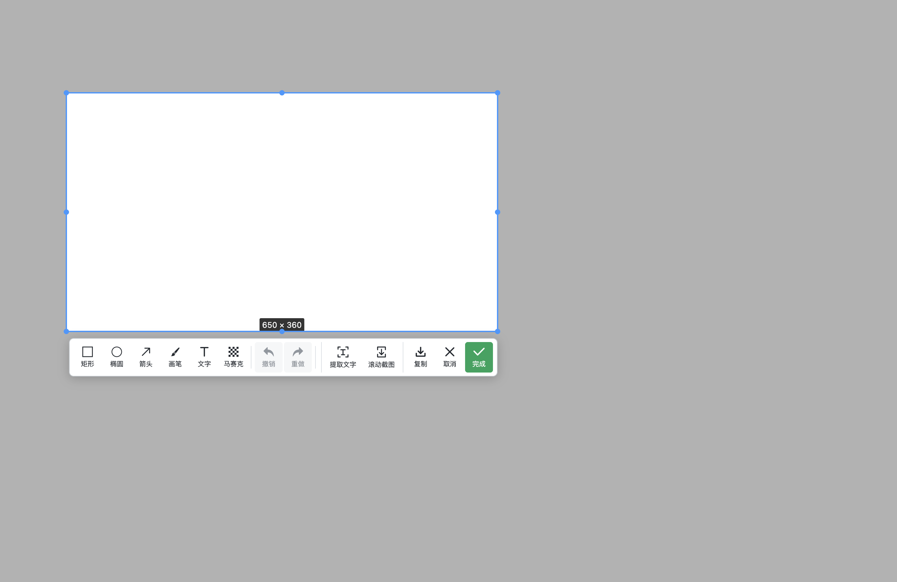

# v0.8.0 验证记录

应用测试提交：`9913dabe5ca3561f649909ec0bae7bf1172b531d`。

## 本机验证

macOS Apple Silicon，本机开发构建和打包构建通过 14 项适用桌面测试；跳过 3 项 Windows 专用测试。额外退出处理变更通过单元测试和原生自动滚动、手动滚动、最小化截图回归。

- 工具栏不存在「完成后」下拉框，点击「提取文字」直接识别并复制，点击「滚动截图」直接进入真实页面。
- 真实独立窗口直接滚动，工具栏保持可见，系统鼠标位置不变；核对最终长图尺寸，固定页头、页脚只保留一次。
- 自动模式真实向下滚动并拼接，底部复制；故意延迟新画面后停止，不再追加或采集。
- 最小化后立即触发截图，使用目标窗口的纹理相关性验证图像内容；支持 Apple P3 等显示配置的颜色差异。
- 新增窗口状态服务的预热、重复请求、服务中断与释放检查；退出时始终等待设置保存，其他清理有时间上限。
- 原版资源没有替换，左右键标记、快捷动作、房间同步与执行记录继续回归。

本机打包后的真实快速截图内部耗时示例：窗口隐藏与状态确认约 13 毫秒、采集约 99 毫秒、图片准备与显示约 44 毫秒，共约 155 毫秒。结果受设备、分辨率与系统动画影响；此值为应用内部计时，不是隐藏设置页的测试脚本调用返回时间。

## 工具栏

## 实现参考

研究了 [eSearch](https://github.com/xushengfeng/eSearch) 的预加载截图窗口与像素缓冲处理方式，使用现有 node-screenshots 原生采集和 react-screenshots 标注。Mac 的窗口状态检查使用 CoreGraphics，Windows 使用 DWM 提交检查；工具栏与生命周期管理在本项目中实现。保留原项目和已有依赖的授权说明。

## GitHub Actions

[CI 构建与验证](https://github.com/liyongliao/lolPing/actions/runs/38426067326) 成功。测试提交与上述应用代码一致。

| 检查 | Windows x64 | macOS Apple Silicon |
| --- | --- | --- |
| 原生 C++ 检查 | 423 通过 | 423 通过 |
| TypeScript 检查 | 748 通过 | 747 通过、1 项平台测试跳过 |
| 打包后桌面测试 | 17 通过，先安装 EXE 再测 | 14 通过、3 项 Windows 专用测试跳过 |
| 一键文字识别、直接滚动、自动滚动、停止复制 | 通过 | 通过 |
| 最小化后截图内容、退出与资源清理 | 通过 | 通过 |

发布复用以上工作流通过验证的安装包；后续仅补充文档与界面截图，应用源码没有变化。
