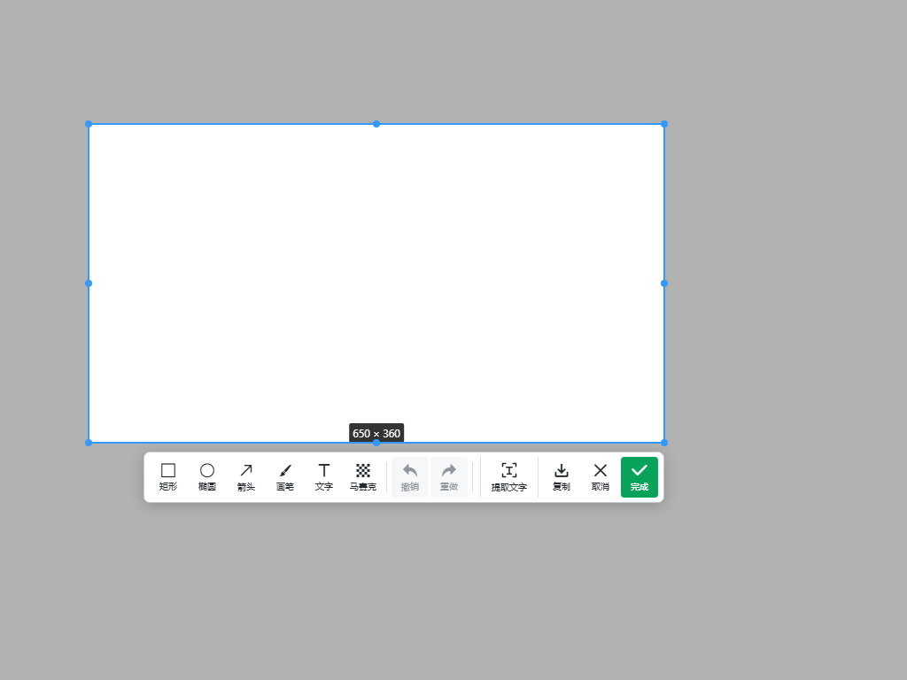

# v0.8.1 验证记录

应用修复提交：`d10eda089201a7d419662a715e43a72f519c9c55`。

Windows 回归脚本使用 SendInput 发出带实际位移的鼠标事件，并检查 Alt 按下状态；仅调用 SetCursorPos 的初版脚本未成功触发轮盘，不能作为置顶测试结果。

## 问题与处理

旧版只在创建轮盘窗口时设置置顶。恢复截图窗口和后续唤起轮盘时没有重新建立窗口层级，也没有保护正在按住的轮盘。这与 Windows 使用一段时间后轮盘仅在桌面可见的反馈相符，但不能仅从静态代码确定用户机器上触发降级的具体操作。

新版在轮盘、标记、表情和提示出现时重新建立置顶层级并提升层序，使用不激活窗口的操作。Windows 按住轮盘期间每 250 毫秒检查一次；释放、取消、截图和退出时停止。截图期间阻止本机和房间消息重新显示轮盘窗口，完成或取消后恢复。

移除滚动截图按钮、IPC、连续采集窗口及拼接逻辑，保留快速截图、标注与一键离线 OCR。原始美术与音效资源未改动。

## 本机验证

- 类型检查通过；48 个单元测试文件通过，747 项通过，1 项平台限定跳过。
- 原生辅助程序：423 项通过。
- Mac 开发构建桌面回归：10 项通过，4 项 Windows 专用测试跳过。
- 实测截图、取消后恢复轮盘、标注 PNG、OCR 剪贴板、最小化后采集内容和双客户端房间鼠标键同步均通过。

## GitHub 安装包验证

[CI 38672313588](https://github.com/liyongliao/lolPing/actions/runs/38672313588) 两端成功，测试提交 `0dab12b955afab7ae2f9fa5e967aa5cefc4f9fb9`。

- Windows：原生测试 423 项通过，单元测试 748 项通过；生成 EXE 并实际安装后，14 项桌面测试全部通过。新增窗口层级专项测试耗时 38 秒，重复三轮后仍通过；前台 HWND 保持为目标应用。
- Mac：原生测试 423 项通过，单元测试 747 项通过、1 项平台跳过；DMG 内应用签名校验通过，10 项桌面测试通过、4 项 Windows 专用测试跳过。
- Release 使用本次 CI 的同一份安装包；发布源码与测试提交之间只增加文档及工具栏截图。

## Windows 专项回归设计

在真实 Windows 桌面上安装本次构建的 EXE，另开独立应用窗口，使用 Win32 API 获取实际窗口层序、WS_EX_TOPMOST、可见性及前台 HWND。测试不以 Electron 的缓存状态作为置顶成功证据。

1. 主动撤销轮盘的原生置顶，并将目标应用设为置顶。
2. 用实际 Alt + 鼠标拖动打开轮盘，验证恢复到目标应用上方，同时目标应用仍为前台。
3. 保持轮盘打开，将另一窗口再次置顶，验证静止轮盘仍能恢复。
4. 重复上述过程三轮，验证释放后还能再次使用。
5. 调用系统“显示桌面”，恢复目标应用后重新使用轮盘。
6. 截图时验证轮盘不可见，截图期间发送标记也不会将其显示；取消截图后验证层级恢复。

这些测试覆盖窗口层级被改变后的恢复，不等同于在所有 Windows 软件上持续数小时的兼容性验证。安全桌面与独占全屏不属于普通桌面覆盖窗口的能力范围。

## Windows 高级截图工具栏

